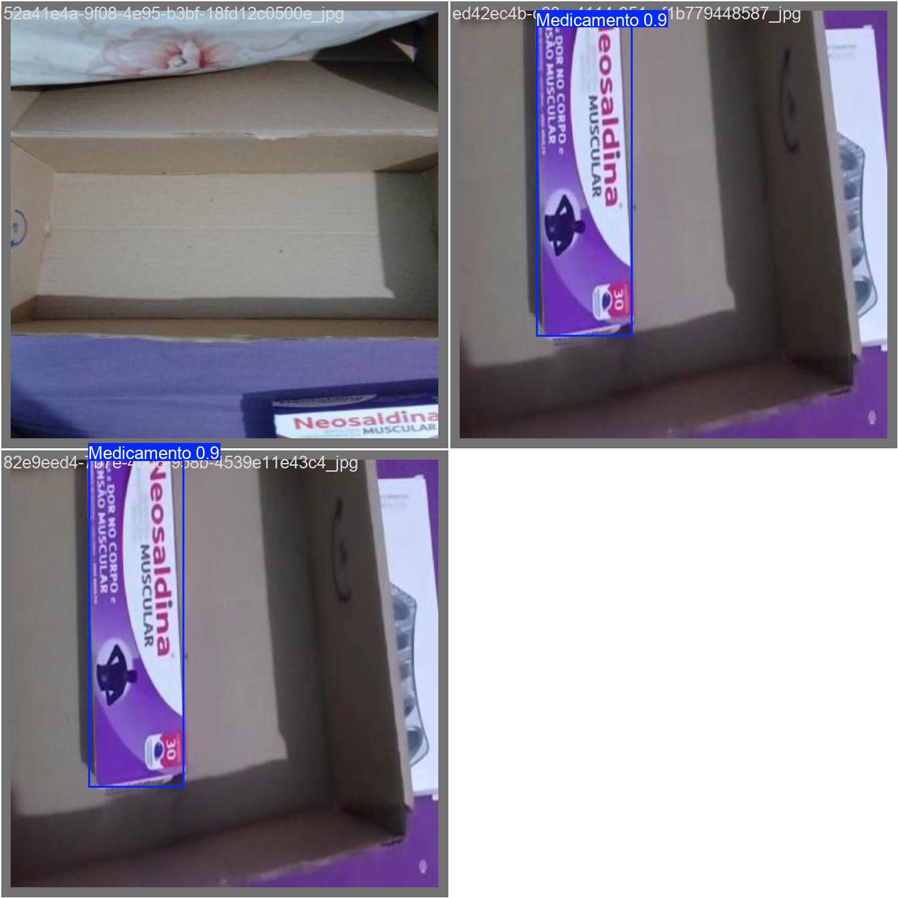
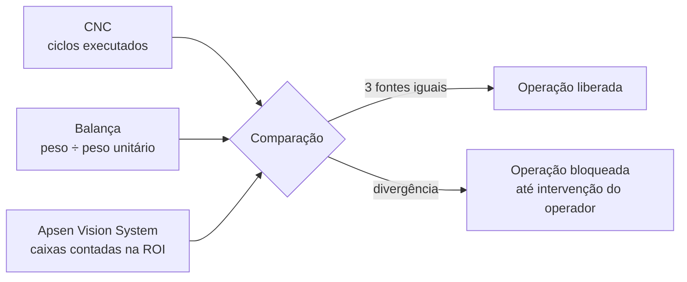
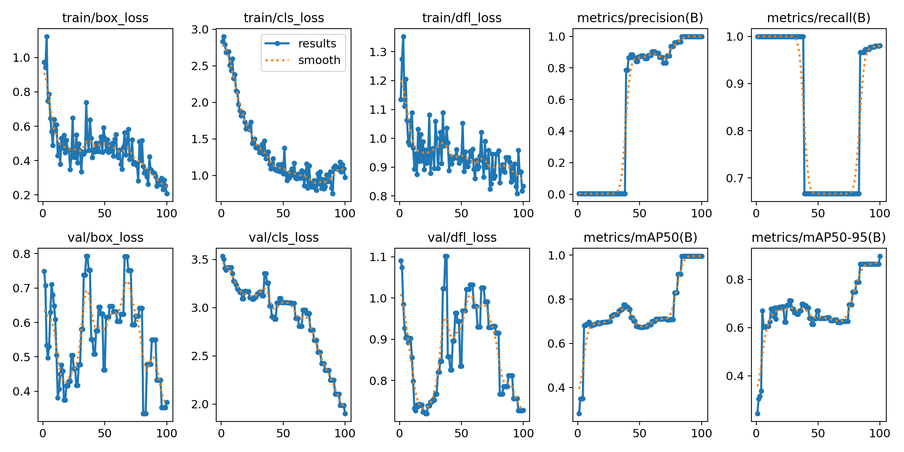

<div align="center">

# Apsen Vision System

**Contagem de caixas de medicamento por visão computacional, a terceira camada de validação da VALORY**

1º lugar no FIAP NEXT 2026, no Challenge Pharma Robotics proposto pela **Apsen Farmacêutica** em parceria com a **Softtek**




</div>

---

## O papel deste módulo

A VALORY é uma célula robótica com CNC cartesiana e 8 dispensers que separa medicamentos com **zero divergência**. Toda operação é confirmada por três fontes independentes:



O **Apsen Vision System** é a fonte visual: uma câmera sobre a bancada detecta cada caixa com um modelo YOLOv11 treinado nas embalagens reais e conta as que entram na **região de interesse (ROI)**.

## Destaques

- **Modelo próprio:** YOLOv11n ajustado com fine-tuning em fotos reais das caixas da bancada, anotadas no Roboflow
- **Contagem por cruzamento de ROI, não por frame:** o rastreador mantém o ID de cada caixa, então ela é contada uma vez só
- **ROI calibrável com o mouse:** `calibrar_roi.py` salva os 4 cantos em `roi.json`, sem editar código
- **Inferência 100% local:** roda numa mini PC com CPU, sem depender de nuvem na produção
- **Log por sessão:** `logs/contagem_AAAAMMDD.log` com início, erros e contagem final
- **Pipeline de dados completo:** coleta de imagens, treino local ou via Roboflow e troca do modelo

---

## Resultados do treino

| Experimento | Épocas | Precisão | Recall | mAP@50 | mAP@50-95 |
|---|---|---|---|---|---|
| `detector_caixas_real` | 100 | 1,000 | 0,981 | 0,995 | **0,896** |
| `detector_caixas_real-2` | 100 | 1,000 | 0,987 | 0,995 | 0,847 |



> **Leitura correta:** as métricas foram medidas na validação de um dataset pequeno, com poucas dezenas de imagens da mesma bancada e iluminação. Elas mostram que o modelo aprendeu bem aquele cenário, mas não garantem desempenho em outra câmera ou outra luz. Ampliar o dataset é o primeiro item do roadmap.

---

## Como rodar

```bash
pip install -r mynd_vision_system/requirements.txt
cd mynd_vision_system/mynd_vision_system

python calibrar_roi.py              # 1. clique nos 4 cantos da área → roi.json
python main.py                      # 2. câmera 0, modelo models/best.pt, conf 0.6
python main.py --source video.mp4   #    ou um vídeo gravado
python main.py --source 1 --conf 0.5
```

Pressione `Q` para encerrar. A contagem aparece na tela (`MYND BOX COUNT`) e vai para o log.

### Calibração da ROI

| Tecla | Ação |
|---|---|
| clique | marca um canto (4 no total) |
| `R` | recomeça |
| `S` | salva `roi.json` |
| `Q` | sai sem salvar |

Sem `roi.json`, o sistema usa a ROI padrão para 1280×720. Refaça a calibração sempre que mudar a câmera, a altura ou a resolução.

---

## Treinar com novos dados

```bash
python coletar_dados.py     # S salva o frame, Q sai → dataset/train/images/
# anote as imagens no Roboflow e exporte em formato YOLOv11
python treinar_local.py     # 100 épocas, imgsz 640, base yolo11n.pt
# copie runs/.../weights/best.pt para models/best.pt
```

| Parâmetro | Valor |
|---|---|
| Modelo base | `yolo11n.pt` (nano, ideal para CPU) |
| Épocas | 100 |
| Tamanho da imagem | 640 |
| Rastreador | BoT-SORT (padrão Ultralytics) |
| Confiança em produção | 0,6 |
| Dispositivo | CPU (use `device=0` com GPU NVIDIA) |

`download_model.py` baixa o dataset pela API do Roboflow. Coloque a sua chave numa variável de ambiente, nunca no código.

---

## Estrutura

```
Apsen-vision-system/
├── README.md
├── docs/                              # imagens de métricas usadas neste README
└── mynd_vision_system/
    ├── requirements.txt
    ├── main.py                        # protótipo com modelo OBB genérico
    └── mynd_vision_system/            # versão de produção
        ├── main.py                    # MyndIndustrialEngine (CLI, roi.json, log)
        ├── calibrar_roi.py            # calibração da ROI com o mouse
        ├── coletar_dados.py           # captura de imagens para o dataset
        ├── treinar_local.py           # treino com dataset local
        ├── treinar.py                 # treino via Roboflow
        ├── download_model.py          # download do dataset (Roboflow API)
        ├── models/best.pt             # modelo treinado (5,2 MB)
        └── dataset/                   # imagens e labels YOLO
```

## Roadmap

- [ ] Ampliar o dataset (meta: 300+ imagens, variando luz, ângulo e posição) e separar treino, validação e teste
- [ ] Unificar as classes: `data.yaml` declara 1 classe, mas os labels usam 2
- [ ] Publicar a contagem via HTTP para o computador central (porta 8202 da arquitetura VALORY)
- [ ] Exportar para ONNX/OpenVINO e medir FPS na mini PC
- [ ] Integrar a visão da mesa (OpenCV clássico) com a dos dispensers

## Projetos relacionados

- [Valory-Electronics](https://github.com/RomuloEXavier2/Valory-Electronics): esquemáticos e PCBs da célula
- [Apsen-App](https://github.com/RomuloEXavier2/Apsen-App): aplicação de gestão logística (WMS)

## Créditos

**Equipe Valory:** Rômulo Estevam Xavier, Gustavo Paraszczuk de Azevedo Marques, Jennifer de Souza, Fernando Bertolucci, João Antonio Domingues Gonçalves e Leonardo Ken Stefano
**Instituição:** FIAP · **Desafio:** Apsen Farmacêutica + Softtek

Desenvolvido por [Rômulo Estevam Xavier](https://www.linkedin.com/in/romulo-estevam-xavier/) · MYND (Make Your New Dreams)
